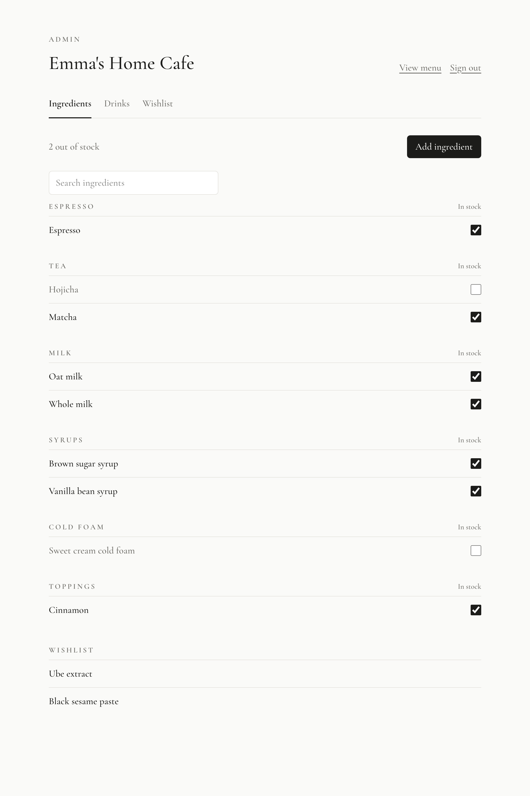
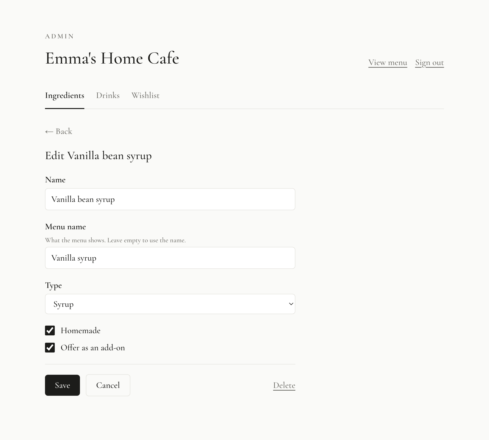
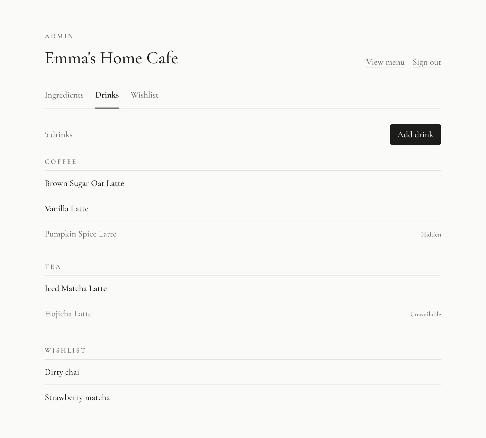
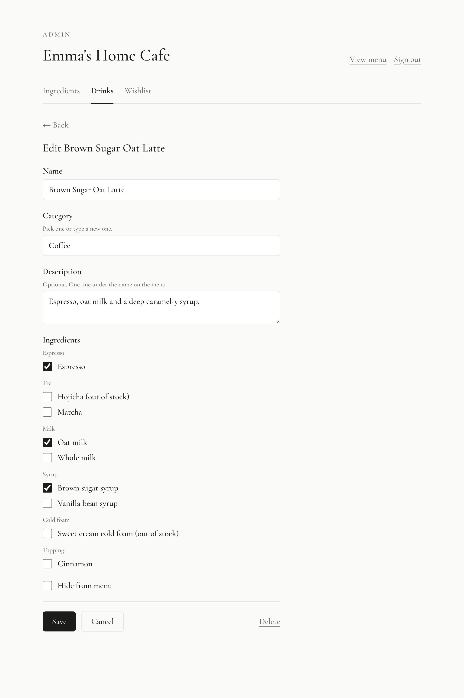
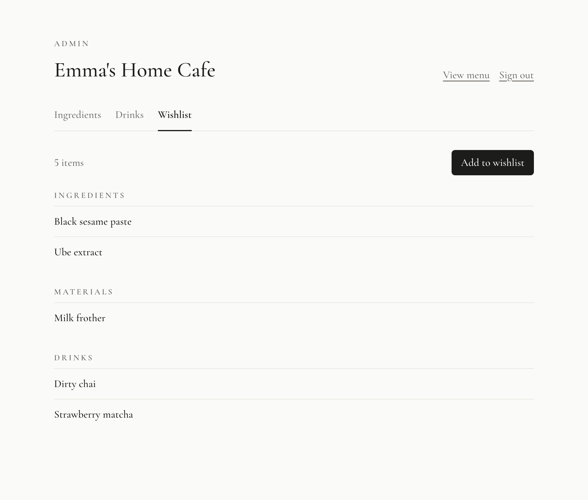

# Emma's Home Cafe

Hello! I really enjoy tea and making drinks at home (and it saves money).

This is where I keep my current menu of drinks and what's on my wishlist.

View the menu: [emmas-cafe.vercel.app](https://emmas-cafe.vercel.app)

## Admin

I sign in with Google to manage everything from one page. Only my account can make changes. (Screenshots use example data.)

### Ingredients

Check off what's in stock. Anything out of stock greys out the drinks that use it on the menu.

Tap an ingredient to edit it: the name on the menu, its type, whether it's homemade, and whether it's offered as an add-on.

### Drinks

Drinks are grouped into sections. Drag a section title to reorder the sections on the menu.

Tap a drink to change its name, section, description and ingredients, or hide it from the menu.

### Wishlist

Ingredients, materials and drinks I want to get or try. When I get one, I can add it straight to my ingredients or drinks.

